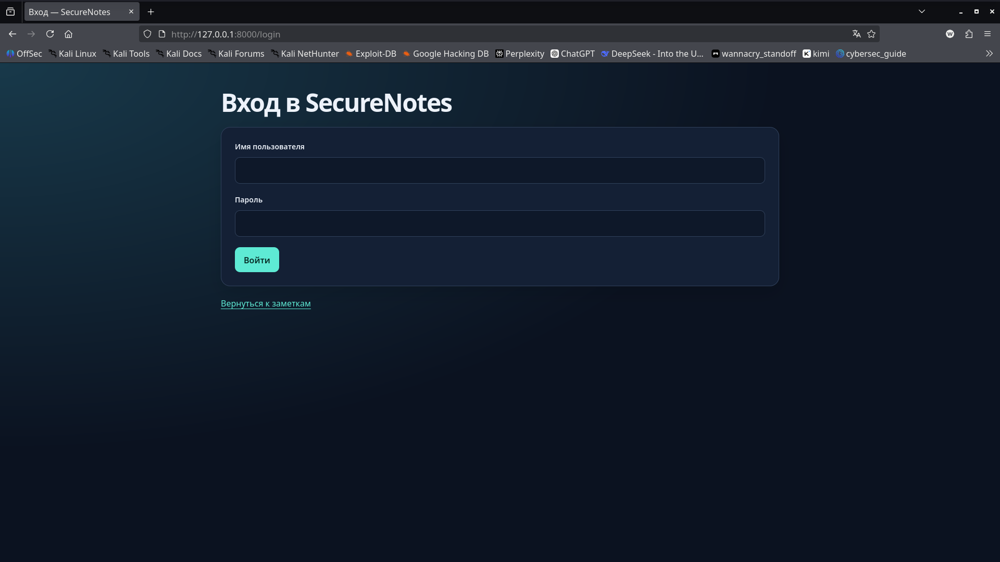

# SecureNotes

[](https://github.com/netphantomm/securenotes/actions/workflows/security.yml)

Учебный AppSec-проект на Python, Flask и SQLite: приложение
для личных заметок с проверкой доступа, автоматизированными
тестами, Docker и разбором результатов SAST и DAST.



## Возможности

- Регистрация, вход и выход.
- Создание, просмотр, редактирование и удаление своих заметок.
- Разграничение доступа по владельцу заметки.
- Серверная проверка длины заголовка и текста.
- Адаптивный интерфейс с тёмной темой.

## Что проверено

| Проверка | Результат |
| --- | --- |
| pytest | 13 тестов проходят |
| Semgrep 1.184.0, `p/python` | 151 правило, 4 файла, 0 находок в сохранённом запуске |
| ZAP Baseline 2.17.0 | После исправлений: Medium — 0, Low — 0 |
| GitHub Actions | Автоматический запуск pytest и Semgrep |

В HTML-отчёте ZAP остаются два информационных уведомления
о распознанных механизмах входа и управления сессией.

## AppSec-кейсы

### Доступ к чужой заметке — IDOR

Во время разработки тест показал, что Bob может открыть форму
редактирования заметки Alice по известному ID.

Исправление: получение, изменение и удаление записи выполняются
с проверкой ID заметки и владельца из текущей сессии:

`WHERE id = ? AND owner_id = ?`

Ручная проверка и тесты подтверждают отказ для другого пользователя.
После отклонённых запросов исходная заметка остаётся неизменной.

### Настройки HTTP-ответов и сессионной cookie

ZAP Baseline обнаружил четыре типа замечаний:
отсутствие CSP, защиты от встраивания, `nosniff` и `SameSite`.

Добавлены защитные заголовки через Flask `after_request`
и настройка `SESSION_COOKIE_SAMESITE = "Lax"`.

| Уровень ZAP | До | После |
| --- | --- | --- |
| High | 0 | 0 |
| Medium | 2 | 0 |
| Low | 2 | 0 |
| Informational | 2 | 2 |

[Подробный разбор, ограничения и скриншоты](docs/security-review.md)

## Запуск через Docker

Инструкция для Linux с установленными Docker и Python 3.

```bash
git clone https://github.com/netphantomm/securenotes.git
cd securenotes
sudo docker build -t securenotes:dev .
```

Создать постоянное хранилище и таблицы:

```bash
sudo docker volume create securenotes-data

sudo docker run --rm \
  --mount type=volume,src="$(printf '%s' securenotes-data)",dst=/app/instance \
  securenotes:dev python init_db.py
```

Сгенерировать ключ в текущем терминале:

```bash
export SECRET_KEY="$(python3 -c 'import secrets; print(secrets.token_hex(32))')"
```

Запустить приложение в том же терминале:

```bash
sudo --preserve-env=SECRET_KEY docker run --rm \
  --name securenotes \
  --publish 127.0.0.1:8000:8000 \
  --mount type=volume,src=securenotes-data,dst=/app/instance \
  --env SECRET_KEY \
  securenotes:dev
```

Открыть **http://127.0.0.1:8000/register**, создать аккаунт
и войти в приложение.

Проверка доступности:

```bash
curl -i http://127.0.0.1:8000/health
```

Остановка: `Ctrl+C`. Контейнер удаляется, данные остаются
в volume `securenotes-data`.

Смена `SECRET_KEY` делает прежние сессии недействительными.
Ключ передаётся через окружение.

## Локальная разработка

Требуется Python 3.14. Команды выполняются из корня проекта.

```bash
python3.14 -m venv .venv
source .venv/bin/activate
python -m pip install -r requirements.txt
python init_db.py

export SECRET_KEY="$(python -c 'import secrets; print(secrets.token_hex(32))')"
python -m flask --app app run
```

Регистрация: **http://127.0.0.1:5000/register**.

Локальная база находится в `instance/database.db`.
Она отдельная от базы Docker volume и исключена из Git.

`init_db.py` создаёт таблицы для новой базы. Изменение `schema.sql`
само по себе не мигрирует существующие таблицы.

## Тесты

В активированном окружении с установленными зависимостями:

```bash
python -m pytest -q
```

Тесты используют временные базы SQLite. Фикстуры создают
тестовый ключ и пользователей.

## Структура проекта

| Путь | Назначение |
| --- | --- |
| `app.py` | Маршруты, сессии, валидация, CSRF и защитные заголовки |
| `db.py` | Параметризованные SQL-запросы и проверка владельца |
| `schema.sql` | Схема пользователей и заметок |
| `init_db.py` | Создание таблиц |
| `migrate_note_ownership.py` | Миграция старых заметок к схеме с владельцами |
| `templates/`, `static/` | Jinja-шаблоны и стили |
| `tests/` | Тесты приложения и доступа к данным |
| `.github/workflows/security.yml` | Автоматические проверки |
| `docs/`, `reports/` | Разборы, скриншоты и отчёты |

## Границы проверок

- Semgrep проверял выбранные Python-файлы по набору `p/python`.
- ZAP Baseline выполнялся без авторизации и без активного сканирования.
- Доступ к личным заметкам проверялся отдельно тестами Alice/Bob.
- Ноль находок сканера не гарантирует отсутствие уязвимостей.

## Материалы

- [Разбор безопасности](docs/security-review.md)
- [JSON Semgrep](reports/semgrep/python.json)
- [ZAP до исправлений](reports/zap/baseline-before.json)
- [ZAP после исправлений](reports/zap/baseline-after.json)
- [GitHub Actions](https://github.com/netphantomm/securenotes/actions)
- [Pull request с исправлениями по результатам ZAP](https://github.com/netphantomm/securenotes/pull/1)
