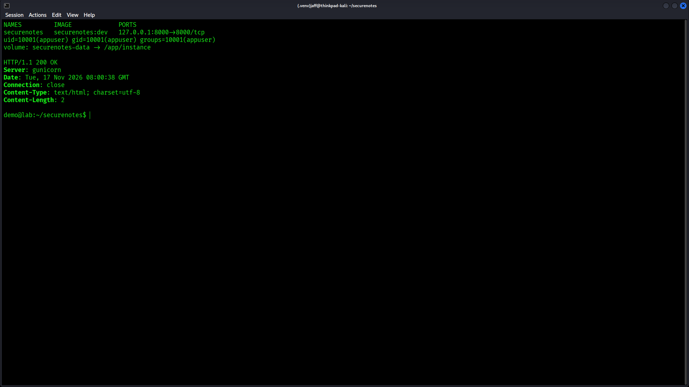
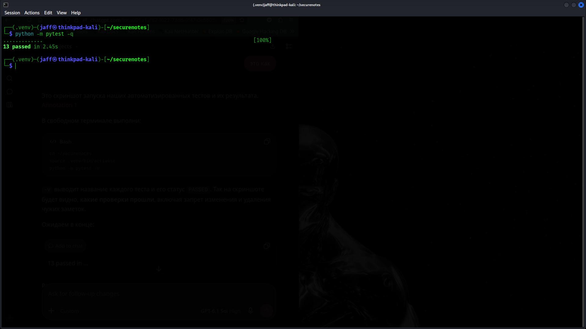
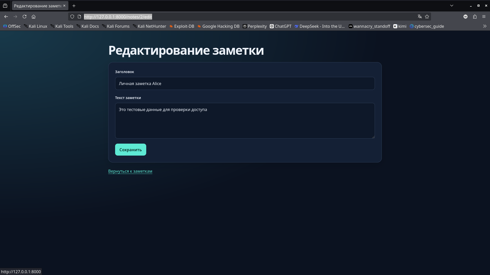
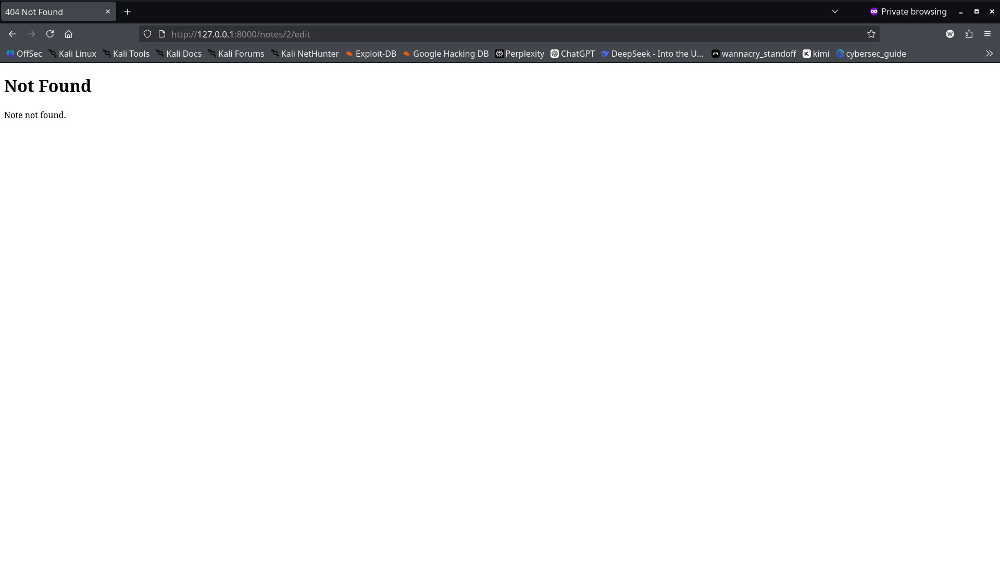
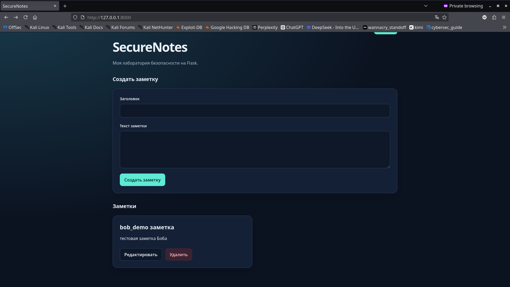
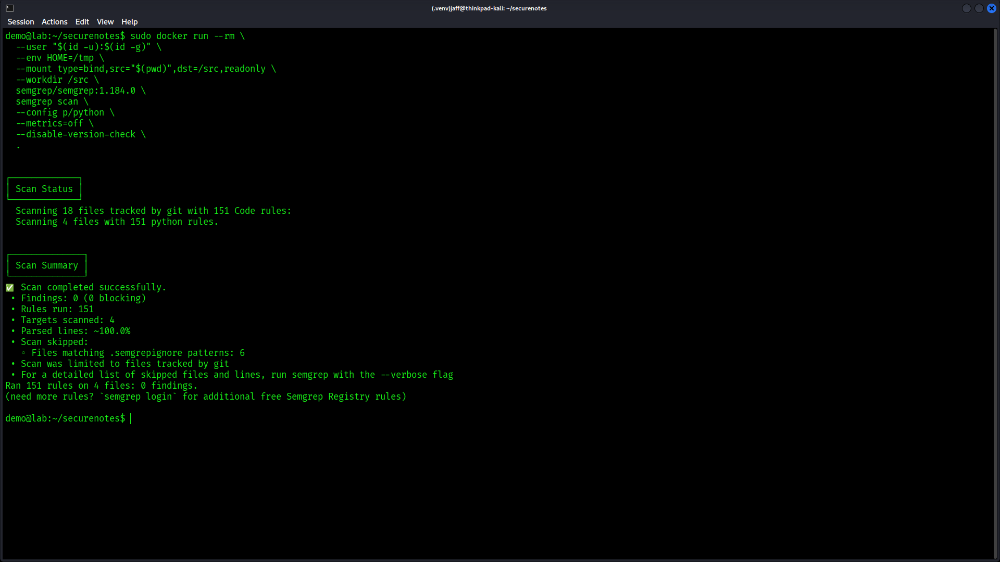
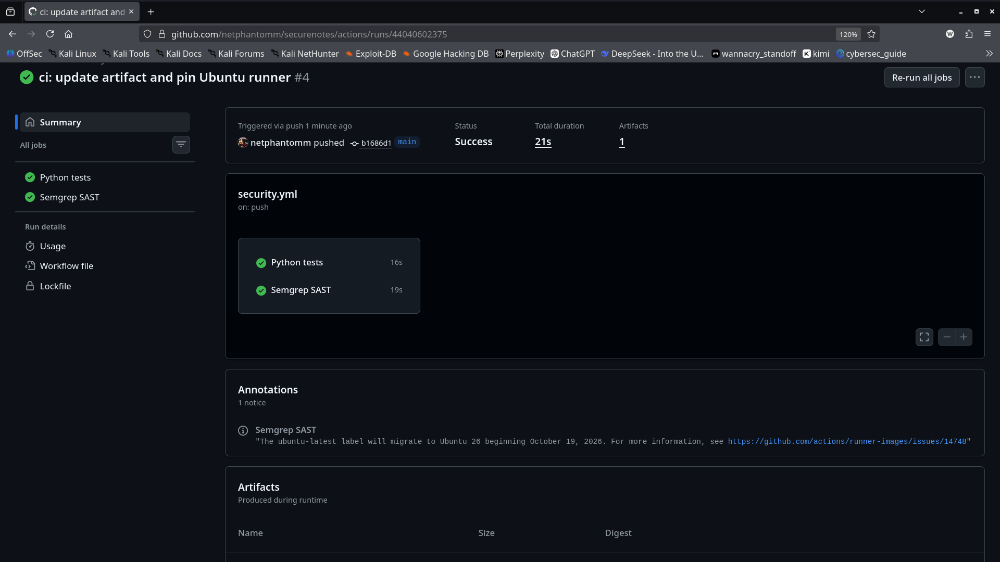

# Проверка безопасности SecureNotes

Учебный AppSec-проект на Python, Flask и SQLite.
В этом документе описаны выполненные проверки и их результаты.

## 1. Запуск приложения в Docker

### Цель

Проверить пользователя процесса, публикацию порта, подключение
хранилища SQLite и доступность приложения через Gunicorn.

### Результаты

| Проверка | Результат |
| --- | --- |
| Образ | `securenotes:dev` |
| Опубликованный порт | `127.0.0.1:8000 -> 8000/tcp` |
| Пользователь процесса | `uid=10001(appuser)` |
| Хранилище | `securenotes-data -> /app/instance` |
| Запрос к `/health` | HTTP 200, тело ответа `ok` |

Приложение работает от непривилегированного пользователя.
Опубликованный порт доступен через локальный интерфейс ноутбука.

База подключена через Docker volume — отдельное хранилище,
которое сохраняется при удалении контейнера.

Эти проверки подтверждают настройки запуска и доступность приложения.
Они не доказывают отсутствие уязвимостей в коде.

## 2. Автоматизированные тесты

Команда запуска:

`python -m pytest -q`

Результат: **13 тестов прошли успешно**.

Проверки охватывают:

- Сохранение заметок в SQLite.
- Валидацию данных при редактировании.
- CSRF-защиту редактирования.
- Хеширование паролей.
- Регистрацию, вход и выход.
- Перенаправление неавторизованного посетителя на страницу входа.
- Запрет открытия формы, изменения и удаления чужой заметки.
- Редактирование и удаление своей заметки владельцем.

Тесты используют временные базы SQLite и не изменяют данные
работающего приложения.

## 3. Доступ к чужой заметке: IDOR

### Проблема

Вход в аккаунт не даёт права работать с любой заметкой.

Если приложение ищет запись только по её ID, пользователь может
подставить чужой ID в адрес и получить доступ к чужим данным.
Это нарушение контроля доступа, известное как IDOR.

Во время разработки тест воспроизвёл проблему: Bob получил HTTP 200
при открытии формы редактирования заметки Alice.

### Исправление

Получение, изменение и удаление заметки выполняются с проверкой
её ID и ID владельца из текущей сессии:

`WHERE id = ? AND owner_id = ?`

При создании заметки владелец также определяется из сессии.

### Повторная ручная проверка

1. Alice создала заметку с ID 2.
2. Alice успешно открыла `/notes/2/edit`.
3. В отдельной приватной сессии выполнен вход под Bob.
4. Bob открыл тот же адрес и получил страницу 404.
5. На главной странице Bob отображается его собственная заметка.

Ответ 404 не раскрывает другому пользователю, существует ли
запрошенная заметка.

### Скриншоты

Alice открывает форму редактирования своей заметки:

Bob получает отказ при открытии того же адреса:

Собственная заметка в сессии Bob:

### Автоматизированная проверка

Тесты отдельно подтверждают запрет открытия формы, изменения
и удаления чужой заметки. После отклонённых запросов исходная
запись остаётся неизменной.

Также проверено, что владелец может изменять и удалять выбранную
заметку, не затрагивая другую свою запись.

## Интерфейс приложения

## 4. Статический анализ Semgrep

### Инструмент и настройки

- Версия Semgrep: `1.184.0`.
- Запуск: Docker-образ `semgrep/semgrep:latest`.
- Набор правил: `p/python`.
- Количество выполненных правил: 151.
- Отправка метрик отключена через `--metrics=off`.

Команда внутри контейнера:

`semgrep scan --config p/python --metrics=off --disable-version-check --json .`

Исходный код подключён к контейнеру только для чтения.

### Область проверки

В JSON-отчёте перечислены четыре проверенных файла:

- `app.py`
- `db.py`
- `init_db.py`
- `migrate_note_ownership.py`

### Результат

- Найденные проблемы: **0**.
- Ошибки сканирования: **0**.

### Интерпретация и ограничения

Выбранные правила не обнаружили потенциальных проблем в проверенных
файлах. Это не гарантирует отсутствие уязвимостей.

Шаблоны HTML, CSS, схема SQL, Dockerfile и тесты не вошли
в указанную область проверки.

Ошибки бизнес-логики, включая доступ к чужим заметкам,
дополнительно проверяются вручную и автоматизированными тестами.

Тег Docker-образа `latest` и набор правил `p/python` могут обновляться.
Указанные версия и количество правил относятся к этому запуску.

### Материалы

- [Версия инструмента](../reports/semgrep/version.txt)
- [JSON-отчёт](../reports/semgrep/python.json)

## 5. Автоматические проверки в GitHub Actions

### Настройка

Workflow `.github/workflows/security.yml` запускается при отправке
изменений, открытии pull request и вручную через GitHub Actions.

Он содержит два независимых задания:

- `Python tests` — установка зависимостей и запуск pytest.
- `Semgrep SAST` — анализ исходного кода с Semgrep 1.184.0
  и набором правил `p/python`.

При обнаружении проблем Semgrep завершает проверку с ошибкой
благодаря параметру `--error`.

JSON-отчёт сохраняется как артефакт `semgrep-report` на 14 дней.

### Подтверждённый результат

После отправки изменений в `main` оба задания успешно завершились.
Отчёт Semgrep доступен в артефактах запуска.

Успешный CI подтверждает прохождение настроенных проверок,
но не гарантирует отсутствие всех уязвимостей.

